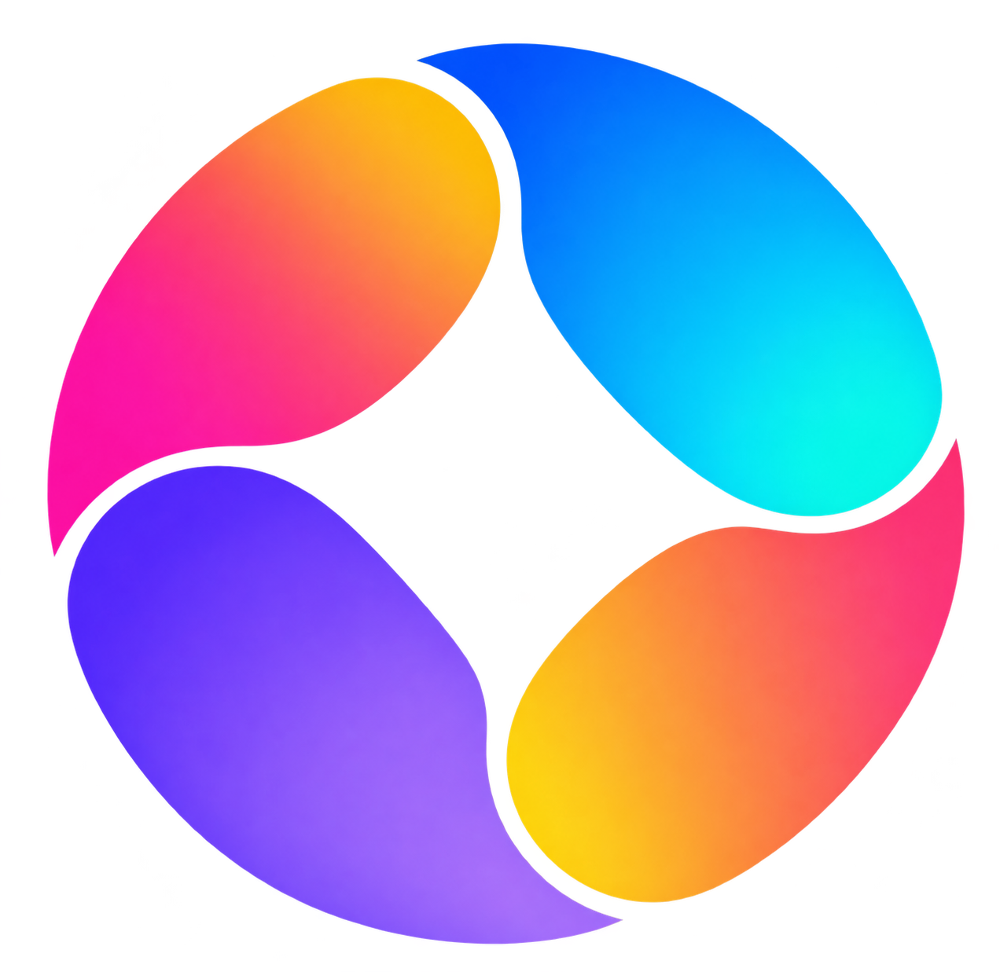
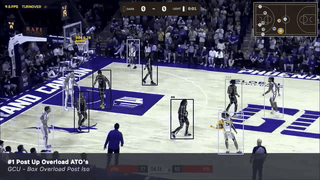
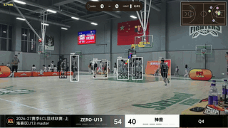
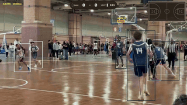
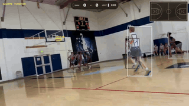

<div align="center">
  
</div>
<h3 align="center"><b>OpenHoopVision</b></h3>
<p align="center">
  <a href="./README.md"></a>
</p>

**TL;DR：** OpenHoopVision 为业余和青少年篮球提供易用的 AI 工具与比赛数据，服务于篮球从业者、教练及其家人。这个可扩展的框架支持接入更多事件、数据和应用；导出的跟踪数据还可用于后续 AI 分析，帮助球队理解比赛并提升水平。

## 演示

<p align="center">
  
  
</p>
<p align="center">
  
  
</p>

## OpenHoopVision 是什么？

OpenHoopVision 逐帧分析篮球比赛视频，检测球员、篮球和场地特征，持续跟踪球员，为球员分配球队标签和全局 ID，并推断篮球动作与控球事件。处理完成后会生成带标注的视频，以及记录逐帧信息和事件的 JSONL 文件。

## 功能

- 检测球员、篮球、篮筐、投篮球员、持球人和裁判。
- 将球员检测结果与姿态关键点和局部轨迹关联起来。
- 估计球队颜色，并通过体育 ReID 和球衣号码 OCR 跨帧匹配球员身份。
- 将检测到的场地关键点映射到球场布局，并绘制迷你地图。
- 在视频证据充分时推断投篮、运球、传球、篮板、失误和抢断。
- 将球员标签、事件状态、记分牌和球场叠加信息绘制到 H.264 视频中。

## 工作原理

视频处理流水线逐帧分析画面，将检测和姿态估计结果与局部跟踪结合，再更新球员身份和事件状态。渲染器和 JSONL 写入器使用同一帧上下文，确保视频画面与记录的数据保持一致。

| 阶段 | 职责 |
| --- | --- |
| 检测与姿态估计 | 检测篮球相关目标，并估计球员和场地关键点。 |
| 局部跟踪 | 在连续视频帧中稳定跟踪球员和篮球。 |
| 身份与球队 | 跨帧匹配球员图像、识别球队，并收集球衣号码读数。 |
| 事件推断 | 跟踪篮球动作和控球变化，处理事件重叠，判断投篮归属并更新记分牌。 |
| 输出 | 绘制分析结果，并生成带标注的视频和逐帧 JSONL 记录。 |

### 投篮事件（Shot Event）

OpenHoopVision 使用专门的检测器识别篮球动作和控球变化，再在统一时间线上处理重叠事件。已确认的投篮事件优先于与其重叠的传球。传球需要有明确的篮球转移证据和稳定的接球控制；如果已知传球者所属球队，还要求接球者属于同一球队。

投篮检测器结合篮球运动轨迹和篮筐信息，将投篮与运球区分开来，并将结果标记为 `made`、`miss` 或 `unknown`。当场地位置可靠时，系统根据位置计算两分或三分；否则会使用并明确标记为两分的默认值。

## 性能与模型指标

| 指标 | 结果 |
| --- | --- |
| RF-DETR 检测器（`Basketball-Detection-v6`） | mAP@0.5：84.9%；mAP@0.5:0.95：62.3% |
| YOLO26s 场地姿态模型（`court-detection-v2`） | mAP@0.5：96.8%；mAP@0.5:0.95：81.1% |
| 端到端投篮流水线（`basketball-event-recognition`） | 精确率：85.51%；召回率：83.10%；F1：84.29%；球队归属准确率：79.66%（47/59） |

所有数据集均由项目团队整理和标注，模型指标使用验证集计算。端到端指标覆盖 7 段视频中的 71 次投篮，按时间 IoU ≥ 0.5 进行一对一匹配。对于一条不完整的标注，投篮开始时间允许 ±0.5 秒的误差。

## 运行 OpenHoopVision

### 环境要求

- Python 3.10 或更高版本。
- H.264 视频输出需要 FFmpeg。请从 [FFmpeg 官方下载页面](https://ffmpeg.org/download.html) 安装适用于当前平台的版本，并确保 `ffmpeg` 可从 `PATH` 中访问。
- 需要下方列出的模型权重文件。程序会读取对应路径中的文件，不会自动下载。
- 建议使用 NVIDIA GPU 以获得实用的处理速度。CUDA 不可用时，程序会使用 CPU 推理。

在仓库根目录安装项目及其依赖：

```bash
python -m pip install -e .
```

`requirements.lock` 记录了已验证的 CUDA 13.0 环境所使用的直接依赖版本。如需安装这些版本：

```bash
python -m pip install -r requirements.lock
python -m pip install -e . --no-deps
```

### 模型权重

默认权重路径相对于项目目录：

| 组件 | 默认路径 |
| --- | --- |
| 篮球检测器 | `weights/rf-detr-basketball.pth` |
| 球员姿态模型 | `weights/yolov8n-pose.pt` |
| 场地姿态模型 | `weights/yolo26s-pose-court-33kp.pt` |
| 球员 ReID | [`weights/sports_model.pth.tar-60`](https://github.com/sjc042/gta-link/tree/main/reid_checkpoints) |
| 球衣号码 OCR | `weights/basketball_jersey_number.ckpt` |

### 分析视频

在项目目录中运行，并通过 `--video` 指定输入视频：

```bash
python main.py --video {your_video}.mp4
```

运行 `python main.py --help` 可查看所有检测阈值、跟踪设置、模型路径和输出选项。

### 输出文件

- `--output` 用于指定带标注的 H.264 MP4 视频。默认路径为从项目目录运行时的 `../output.mp4`。
- `--tracks` 用于指定 JSONL 文件，每帧写入一个 JSON 对象。默认路径为 `../tracks.jsonl`。

每条 JSONL 帧记录都使用 `basketball_frame_v2` 结构，包含帧编号、时间戳、球员、持球人、篮球和篮筐特征、原始检测结果及事件。第一条记录还包含本次运行的配置。事件记录使用帧区间，并包含事件专属字段，例如投篮结果和得分、传球接球人或篮板类型。

## 项目结构

| 路径 | 作用 |
| --- | --- |
| `main.py` | 读取命令行参数并启动视频分析。 |
| `pipeline/` | 协调逐帧处理，并在各阶段间传递结果。 |
| `models/` | 加载视觉模型，并将模型输出转换为流水线可用的数据。 |
| `tracking/` | 跨帧跟踪球员和篮球，并估计球队和场地位置。 |
| `reid/` | 匹配不同轨迹中的球员身份，并将球衣号码读数作为辅助依据。 |
| `events/` | 检测篮球动作和控球变化，判断事件归属并计算得分。 |
| `render/` | 在画面上绘制分析结果并输出带标注的视频。 |
| `assets/` | 存放项目标志和本 README 展示的演示动图。 |

## 当前范围

目前系统可以推断投篮、运球、传球、篮板、失误和抢断；暂不支持助攻、盖帽和犯规。如果场地位置不可靠，系统会使用并标记为两分的默认得分。

已知限制：遮挡、镜头切换和低分辨率画面可能导致篮球跟踪、球员身份识别和事件结果不可靠。低机位若无法看清场地边线，迷你地图可能无法正常工作。流水线目前离线处理录制视频；没有性能足够的 GPU 时处理速度可能较慢，模型权重也需要单独准备。

下一步，我正在探索基于本项目开发实用工具，例如自动生成比赛集锦，敬请期待！

## 参考项目

[RF-DETR](https://github.com/roboflow/rf-detr) — 用于加载篮球检测器权重的目标检测框架。

[Ultralytics](https://github.com/ultralytics/ultralytics) — YOLO 运行时，用于加载球员 [YOLOv8 姿态模型](https://docs.ultralytics.com/models/yolov8/) 和场地 [YOLO26 姿态模型](https://docs.ultralytics.com/models/yolo26/) 权重。

[McByte++](https://github.com/tstanczyk95/McBytePlusPlus) — 本地跟踪实现和体育 ReID 权重参考的来源。

[ByteTrack](https://github.com/FoundationVision/ByteTrack) — 本地跟踪器所采用的高低置信度关联方法和卡尔曼滤波基础。

[OSNet / Torchreid](https://github.com/KaiyangZhou/deep-person-reid) — 在 [`models/appearance.py`](models/appearance.py) 中改编的 OSNet x1.0 架构。

[PARSeq](https://github.com/baudm/parseq) — 在 [`models/jersey_number.py`](models/jersey_number.py) 中改编、用于球衣号码识别的 OCR 架构。

## 许可证

OpenHoopVision 的原创代码和项目训练的模型文件依据 [Apache License 2.0](https://www.apache.org/licenses/LICENSE-2.0) 发布。第三方模型、代码和依赖仍遵循各自的许可证，其中包括 [Ultralytics 的 AGPL-3.0 许可证](https://github.com/ultralytics/ultralytics/blob/main/LICENSE)。演示动图由网上视频截取制作，原视频仍受各自版权和相关条款约束。
